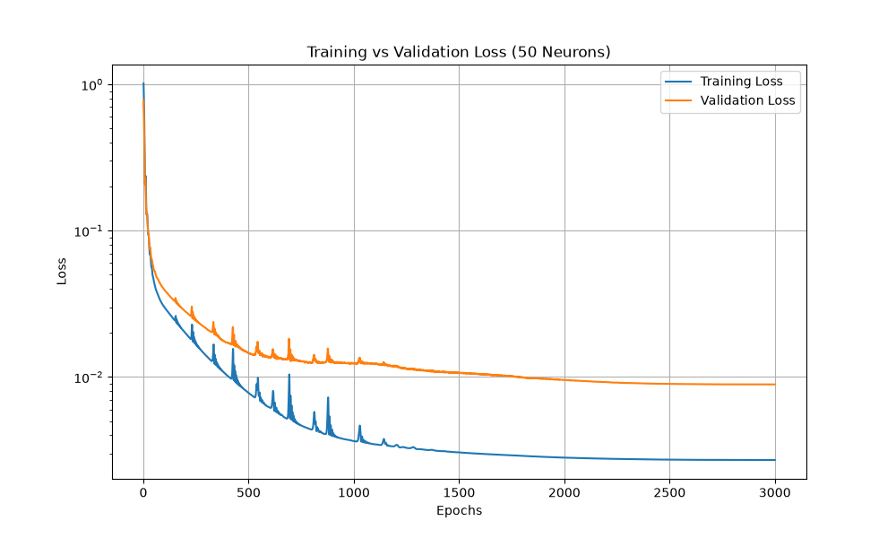
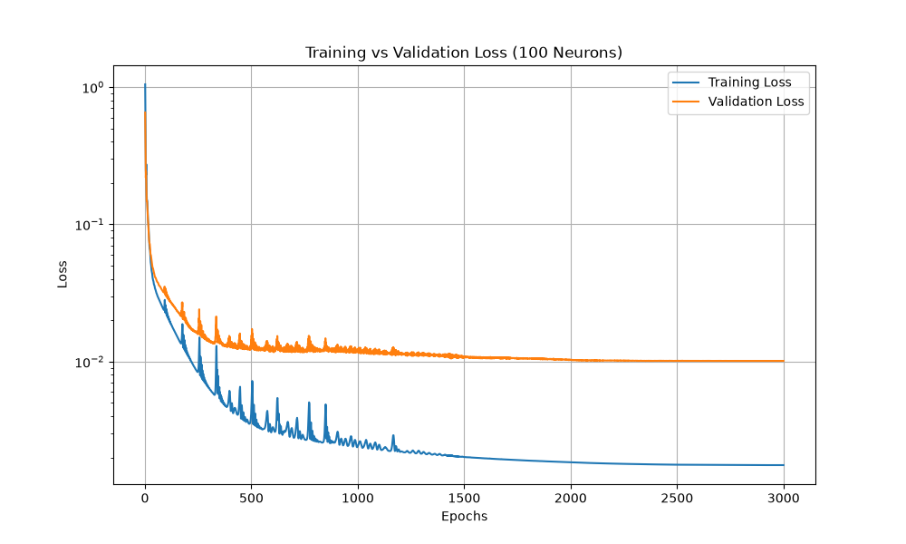
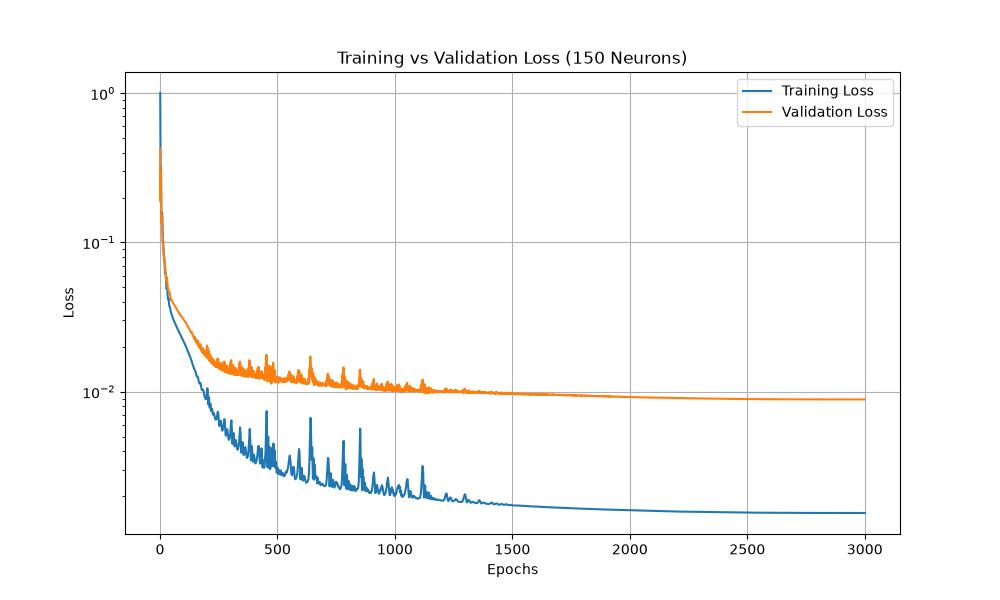
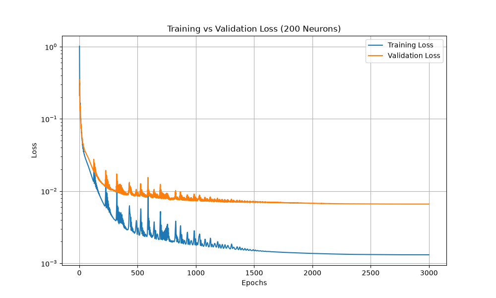
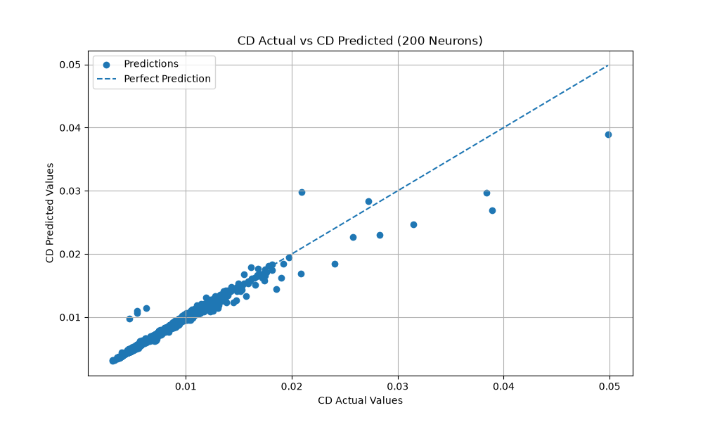

# Neural Network-Based Airfoil Aerodynamic Performance Prediction

## Project Overview

This project investigates the application of **Artificial Neural Networks (ANNs)** to predict the aerodynamic performance of airfoil geometries under varying flow conditions. A feedforward neural network was developed in Python using PyTorch and trained using aerodynamic simulation data generated with XFOIL.

The model predicts three fundamental aerodynamic coefficients: **lift coefficient (CL), drag coefficient (CD), and moment coefficient (CM)**. Rather than requiring a new XFOIL simulation for every prediction, the trained neural network approximates the relationship between airfoil geometry, flow conditions, and aerodynamic performance.

A dataset containing **200 unique NACA four-digit airfoil geometries** was generated and evaluated across different angles of attack, Reynolds numbers, and Mach numbers. The resulting dataset was used to train, validate, and independently test the neural network.

The primary objective was to evaluate the ability of a neural network to generalize to airfoil geometries that were not included in the training dataset.

## Methodology

The project was developed using **Python, PyTorch, NumPy, Pandas, and Matplotlib**, with XFOIL serving as the aerodynamic simulation tool used to generate training data.

### Airfoil Geometry Generation and XFOIL Simulations

A Python program was developed to generate unique NACA four-digit airfoil geometries by varying:

- Maximum camber
- Position of maximum camber
- Maximum thickness

The generated airfoil coordinates were supplied to XFOIL to calculate aerodynamic performance under different operating conditions.

The simulations varied:

- **Angle of attack:** -2° to 8°
- **Reynolds number:** Eight different Reynolds number conditions
- **Mach number:** 0.0, 0.1, 0.2, and 0.3

XFOIL-generated lift, drag, and moment coefficients were collected and organized into a structured dataset for machine-learning development.

### Dataset Preparation and Processing

The dataset contained seven input parameters and three output parameters.

**Input parameters:**

- Maximum camber
- Camber position
- Maximum thickness
- Chord length
- Angle of attack
- Reynolds number
- Mach number

**Predicted aerodynamic outputs:**

- Lift coefficient (CL)
- Drag coefficient (CD)
- Moment coefficient (CM)

The dataset was divided by unique airfoil geometry rather than individual simulation rows to prevent data leakage between training, validation, and testing datasets.

| Dataset | Unique Geometries | Allocation |
|:---|---:|---:|
| Training | 160 | 80% |
| Validation | 20 | 10% |
| Testing | 20 | 10% |
| **Total** | **200** | **100%** |

All input and output parameters were standardized using the training dataset statistics. The same normalization parameters were then applied to the validation and testing datasets to prevent data leakage during preprocessing.

### Complete Aerodynamic Dataset

The complete dataset contains the generated NACA airfoil geometries, operating conditions, and corresponding XFOIL aerodynamic coefficients.

    <pre id="csv-content" style="margin:0; font-family:monospace; font-size:12px; white-space:pre; color:#222;">Loading aerodynamic dataset...</pre>

    <a href="/airfoil_dataset.csv" target="_blank">Download Complete Dataset (CSV)</a>

### Artificial Neural Network Architecture

A fully connected feedforward neural network was implemented using PyTorch.

The network consisted of:

- Seven input neurons
- Two fully connected hidden layers
- Leaky ReLU activation functions
- Three output neurons corresponding to CL, CD, and CM

Four network configurations were investigated by varying the number of neurons in each hidden layer:

- 50 neurons per hidden layer
- 100 neurons per hidden layer
- 150 neurons per hidden layer
- 200 neurons per hidden layer

## Training Procedure

Each network configuration was trained for 3,000 epochs using the following training parameters:

- **Optimizer:** Adam
- **Initial learning rate:** 0.01
- **Learning rate scheduler:** Cosine Annealing
- **Loss function:** Mean Squared Error (MSE)
- **Activation function:** Leaky ReLU
- **Epochs:** 3,000

Four network configurations were investigated by varying the number of neurons in each of the two hidden layers: 50, 100, 150, and 200 neurons.

Training and validation losses were recorded at every epoch to monitor convergence and evaluate the ability of each architecture to generalize to previously unseen airfoil geometries.

## Training and Validation Loss Analysis

### 50-Neuron Architecture

The first configuration utilized 50 neurons in each hidden layer. Training and validation losses were monitored throughout the 3,000-epoch optimization process.

*Training and validation loss versus epoch for the 50-neuron architecture.*

### 100-Neuron Architecture

The second configuration increased the number of neurons in each hidden layer to 100. This allowed the effect of increased network capacity on training convergence and validation performance to be evaluated.

*Training and validation loss versus epoch for the 100-neuron architecture.*

### 150-Neuron Architecture

The third configuration utilized 150 neurons per hidden layer to further investigate the relationship between network size and prediction performance.

*Training and validation loss versus epoch for the 150-neuron architecture.*

### 200-Neuron Architecture

The final configuration utilized 200 neurons in each hidden layer. This architecture achieved the lowest final validation loss among the four configurations and was selected for independent testing.

*Training and validation loss versus epoch for the 200-neuron architecture.*

### Training Loss Comparison Across Architectures

The training loss histories of all four architectures were plotted together to compare convergence behavior and the influence of hidden-layer size on optimization.

*Comparison of training loss versus epoch for all four neural network architectures.*

### Architecture Performance Comparison

The final training and validation losses for each configuration are summarized below.

| Neurons per Hidden Layer | Training Loss | Validation Loss |
|---:|---:|---:|
| 50 | 0.002709 | 0.008902 |
| 100 | 0.001759 | 0.010113 |
| 150 | 0.001538 | 0.008874 |
| 200 | 0.001312 | 0.006616 |

The 200-neuron architecture achieved the lowest final training and validation losses. Although the 100-neuron architecture had a slightly higher validation loss than the 50-neuron configuration, increasing the network width to 150 and 200 neurons produced progressively lower validation losses.

Based on these results, the 200-neuron architecture was selected as the final model.

## Independent Testing Performance

The selected 200-neuron neural network was evaluated using the independent testing dataset, consisting of 20 airfoil geometries that were excluded from both training and validation.

The model predicted lift, drag, and moment coefficients for the testing geometries using their corresponding geometric and flow-condition parameters. Predictions were then compared against the aerodynamic coefficients generated by XFOIL.

### Testing Root Mean Squared Error

Model accuracy was evaluated using the root mean squared error (RMSE) for each aerodynamic coefficient.

| Aerodynamic Coefficient | Testing RMSE |
|:---|---:|
| Lift Coefficient (CL) | 0.005026 |
| Drag Coefficient (CD) | 0.000345 |
| Moment Coefficient (CM) | 0.000772 |

These errors quantify the difference between the neural network predictions and the XFOIL reference values on the independent testing dataset.

### Actual vs. Predicted Lift Coefficient

The predicted lift coefficients were compared against the corresponding XFOIL-generated values for the testing dataset.

*Actual versus predicted lift coefficient (CL) for the independent testing dataset.*

### Actual vs. Predicted Drag Coefficient

The model's ability to predict drag coefficient was evaluated using the same independent testing dataset.

*Actual versus predicted drag coefficient (CD) for the independent testing dataset.*

### Actual vs. Predicted Moment Coefficient

The predicted moment coefficients were compared against the XFOIL reference values to evaluate the model's performance across the third aerodynamic output.

*Actual versus predicted moment coefficient (CM) for the independent testing dataset.*

The three comparisons provide an independent assessment of the selected neural network's ability to reproduce XFOIL aerodynamic predictions for airfoil geometries that were not used during model training.

## Major Findings

- A feedforward artificial neural network was developed to predict lift, drag, and moment coefficients using seven airfoil geometry and flow-condition parameters.
- A dataset containing 200 unique NACA four-digit airfoil geometries was generated using XFOIL.
- Dividing the dataset by unique airfoil geometry prevented geometries from appearing across multiple dataset partitions.
- Four neural network configurations were evaluated using 50, 100, 150, and 200 neurons per hidden layer.
- The 200-neuron architecture achieved the lowest final validation loss of 0.006616.
- The selected architecture achieved testing RMSE values of 0.005026 for CL, 0.000345 for CD, and 0.000772 for CM.
- The results demonstrate the potential of neural networks as computationally efficient surrogate models for aerodynamic analysis.

## Conclusion

This project established a machine-learning framework for approximating airfoil aerodynamic performance using XFOIL-generated simulation data. A feedforward neural network was developed, trained, and evaluated across 200 unique NACA four-digit airfoil geometries.

The final 200-neuron architecture demonstrated strong predictive agreement with XFOIL-generated aerodynamic coefficients on an independent testing dataset containing 20 previously unseen geometries.

The developed framework provides a foundation for future work involving larger aerodynamic datasets, experimental validation, and machine-learning-assisted airfoil design and optimization.

**Note:** Model performance was evaluated against XFOIL-generated data rather than experimental wind tunnel measurements. The reported accuracy therefore represents agreement with the simulation data used as the reference.
