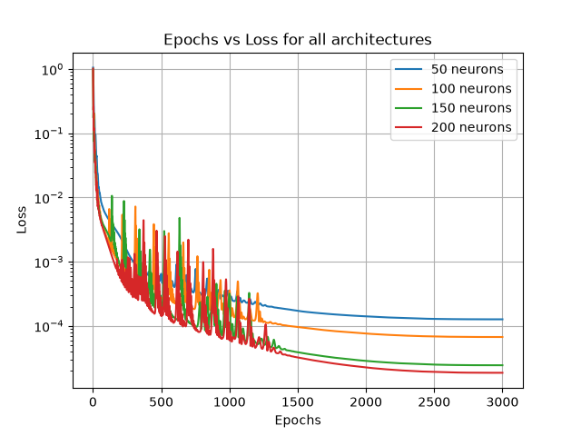
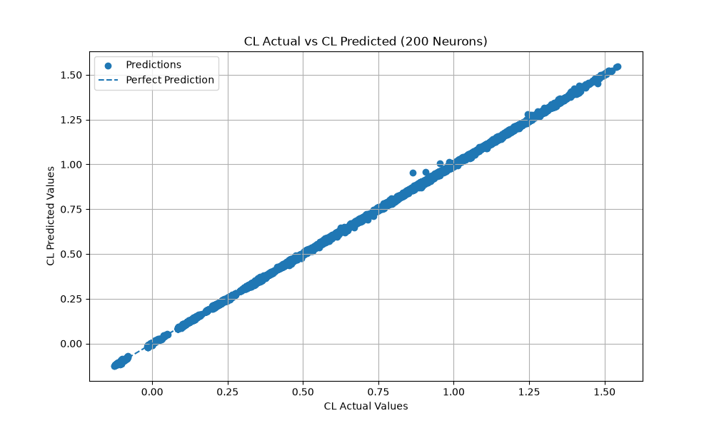
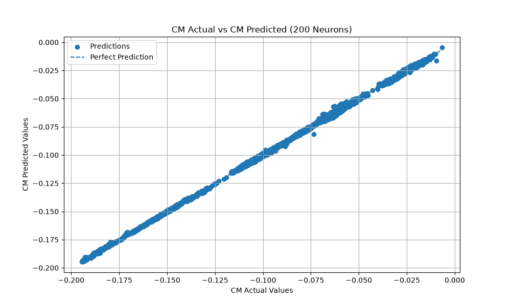

# Neural Network-Based Airfoil Aerodynamic Performance Prediction

## Project Overview

This project investigates the application of **Artificial Neural Networks (ANNs)** to predict the aerodynamic performance of airfoil geometries under varying flow conditions. A feedforward neural network was developed in Python using PyTorch and trained using aerodynamic simulation data generated with XFOIL.

The model predicts three fundamental aerodynamic coefficients: **lift coefficient (CL), drag coefficient (CD), and moment coefficient (CM)**. Rather than requiring a new XFOIL simulation for every prediction, the trained neural network approximates the relationship between airfoil geometry, flow conditions, and aerodynamic performance.

A dataset containing **200 unique NACA four-digit airfoil geometries** was generated and evaluated across different angles of attack, Reynolds numbers, and Mach numbers. The resulting dataset was used to train, validate, and independently test the neural network.

The primary objective was to evaluate the ability of a neural network to generalize to airfoil geometries that were not included in the training dataset.

## Results at a Glance

| Item | Result |
|:---|:---|
| Dataset | 200 unique NACA four-digit airfoils generated with XFOIL |
| Data split | 160 training / 20 validation / 20 testing airfoils (split by geometry) |
| Selected model | Two hidden layers, 200 neurons each |
| Testing RMSE, CL | 0.005026 |
| Testing RMSE, CD | 0.000345 |
| Testing RMSE, CM | 0.000772 |

The selected network reproduces XFOIL lift, drag, and moment coefficients for 20 airfoil geometries it never saw during training or model selection.

## Methodology

The project was developed using **Python, PyTorch, NumPy, Pandas, and Matplotlib**, with XFOIL serving as the aerodynamic simulation tool used to generate training data.

### Airfoil Geometry Generation and XFOIL Simulations

A Python program was developed to generate unique NACA four-digit airfoil geometries by varying:

- Maximum camber
- Position of maximum camber
- Maximum thickness

The generated airfoil coordinates were supplied to XFOIL to calculate aerodynamic performance under different operating conditions.

The simulations varied:

- **Angle of attack:** -2° to 8°
- **Reynolds number:** Eight different Reynolds number conditions
- **Mach number:** 0.0, 0.1, 0.2, and 0.3

XFOIL-generated lift, drag, and moment coefficients were collected and organized into a structured dataset for machine-learning development.

#### Design Space

| Parameter | Range | Sampling |
|:---|:---|:---|
| Maximum camber | 0% to 5% of chord | Random integer |
| Position of maximum camber | 0.2 to 0.6 of chord (set to 0 for symmetric airfoils) | Random integer, in tenths of chord |
| Maximum thickness | 6% to 18% of chord | Random integer |
| Angle of attack | -2° to 8° | 1° steps (11 values) |
| Reynolds number | 1 million to 9 million | One random value from each of eight 1-million-wide bands, rounded to the nearest 10,000, drawn separately for each airfoil |
| Mach number | 0.0 to 0.3 | 0.1 steps (4 values) |

Symmetric airfoils (zero camber) have no camber position, so the position was set to 0 and duplicates were rejected. This gives **338 unique designs** in the parameter space, and the 200 selected airfoils cover about 59% of them. The testing airfoils therefore fall between training airfoils, so this study measures generalization **within** the design space, not extrapolation beyond it.

Each airfoil was simulated at 8 Reynolds numbers, 4 Mach numbers, and 11 angles of attack, for at most 352 points per airfoil and 70,400 points in total. Points at which XFOIL did not converge are absent from the dataset, so some airfoil and flow-condition combinations have fewer than 11 angles of attack.

#### XFOIL Settings

- Viscous analysis at fixed Reynolds and Mach number, with the XFOIL default transition criterion (e^N method, N_crit = 9)
- Airfoil coordinates generated from the NACA four-digit equations (500 points per chord position, repaneled by XFOIL)
- Up to 300 iterations per angle of attack
- Angle of attack sweep from -2° to 8° in 1° steps
- XFOIL's built-in compressibility correction for Mach numbers above 0

### Dataset Preparation and Processing

The dataset contained seven input parameters and three output parameters.

**Input parameters:**

- Maximum camber
- Camber position
- Maximum thickness
- Chord length
- Angle of attack
- Reynolds number
- Mach number

**Predicted aerodynamic outputs:**

- Lift coefficient (CL)
- Drag coefficient (CD)
- Moment coefficient (CM)

> **Note on chord length:** every airfoil was analyzed with a 1 m chord. XFOIL takes the Reynolds number directly, so chord length has no separate effect on the non-dimensional coefficients. It is a constant input, carries no information, and is standardized to zero. The network therefore has six informative inputs.

The dataset was divided by unique airfoil geometry rather than individual simulation rows to prevent data leakage between training, validation, and testing datasets.

| Dataset | Unique Geometries | Allocation |
|:---|---:|---:|
| Training | 160 | 80% |
| Validation | 20 | 10% |
| Testing | 20 | 10% |
| **Total** | **200** | **100%** |

All input and output parameters were standardized using the training dataset statistics. The same normalization parameters were then applied to the validation and testing datasets to prevent data leakage during preprocessing. Network predictions were converted back to the original units of CL, CD, and CM before the RMSE values reported below were calculated.

### Aerodynamic Dataset Preview

The preview below shows the first rows of the generated dataset. The full file can be downloaded with the link below it.

    <pre id="csv-content" style="margin:0; font-family:monospace; font-size:12px; white-space:pre; color:#222;">Loading aerodynamic dataset...</pre>

    <a href="/airfoil_dataset.csv" target="_blank">Download Complete Dataset (CSV)</a>

### Artificial Neural Network Architecture

A fully connected feedforward neural network was implemented using PyTorch.

The network consisted of:

- Seven input neurons
- Two fully connected hidden layers
- Leaky ReLU activation functions
- Three output neurons corresponding to CL, CD, and CM

Four network configurations were investigated by varying the number of neurons in each hidden layer:

- 50 neurons per hidden layer
- 100 neurons per hidden layer
- 150 neurons per hidden layer
- 200 neurons per hidden layer

## Training Procedure

Each network configuration was trained for 3,000 epochs using the following training parameters:

- **Optimizer:** Adam
- **Initial learning rate:** 0.01
- **Learning rate scheduler:** Cosine Annealing (decaying over the 3,000 epochs)
- **Loss function:** Mean Squared Error (MSE) on standardized outputs
- **Activation function:** Leaky ReLU (negative slope 0.01)
- **Batching:** Full batch, with every training row used at every epoch
- **Epochs:** 3,000

Training and validation losses were recorded at every epoch to monitor convergence and evaluate the ability of each architecture to generalize to previously unseen airfoil geometries.

The architecture was chosen using the **final-epoch validation loss**. The testing dataset was not used for any training or model-selection decision and was evaluated once, with the selected network.

## Training and Validation Loss Analysis

The training and validation losses are mean squared errors on the standardized outputs. They are dimensionless, are not in the units of CL, CD, or CM, and are used to compare configurations with each other.

### 50-Neuron Architecture

The first configuration utilized 50 neurons in each hidden layer. Training and validation losses were monitored throughout the 3,000-epoch optimization process.

*Training and validation loss versus epoch for the 50-neuron architecture.*

### 100-Neuron Architecture

The second configuration increased the number of neurons in each hidden layer to 100. This allowed the effect of increased network capacity on training convergence and validation performance to be evaluated.

*Training and validation loss versus epoch for the 100-neuron architecture.*

### 150-Neuron Architecture

The third configuration utilized 150 neurons per hidden layer to further investigate the relationship between network size and prediction performance.

*Training and validation loss versus epoch for the 150-neuron architecture.*

### 200-Neuron Architecture

The final configuration utilized 200 neurons in each hidden layer. This architecture achieved the lowest final validation loss among the four configurations and was selected for independent testing.

*Training and validation loss versus epoch for the 200-neuron architecture.*

### Training Loss Comparison Across Architectures

The training loss histories of all four architectures were plotted together to compare convergence behavior and the influence of hidden-layer size on optimization.

*Comparison of training loss versus epoch for all four neural network architectures.*

### Architecture Performance Comparison

The final training and validation losses for each configuration are summarized below.

| Neurons per Hidden Layer | Training Loss | Validation Loss |
|---:|---:|---:|
| 50 | 0.002709 | 0.008902 |
| 100 | 0.001759 | 0.010113 |
| 150 | 0.001538 | 0.008874 |
| 200 | 0.001312 | 0.006616 |

Training loss fell steadily as the network widened. Validation loss did not follow a smooth trend: the 100-neuron network had a higher validation loss than the 50-neuron network, and the 50- and 150-neuron networks were nearly tied. The 200-neuron architecture had the lowest training and validation losses and was selected as the final model.

Validation loss is about 3 to 6 times larger than training loss for every configuration. This is expected when evaluating on unseen geometries, but it shows that the models fit the training airfoils more closely than the validation airfoils. Each configuration was trained once without a fixed random seed, so small differences between configurations, such as 50 versus 150 neurons, may be within run-to-run variation.

#### Validation RMSE by Aerodynamic Coefficient

The same validation results, converted to the original units of each coefficient, show a clearer ranking:

| Neurons per Hidden Layer | CL RMSE | CD RMSE | CM RMSE |
|---:|---:|---:|---:|
| 50 | 0.008142 | 0.000330 | 0.001400 |
| 100 | 0.005901 | 0.000357 | 0.000958 |
| 150 | 0.005863 | 0.000335 | 0.000884 |
| 200 | **0.004795** | **0.000289** | **0.000779** |

The 200-neuron architecture has the lowest validation RMSE for all three coefficients, which supports its selection beyond the single loss value. The 100-neuron network improved CL and CM over the 50-neuron network but was slightly worse for CD.

## Independent Testing Performance

The selected 200-neuron neural network was evaluated using the independent testing dataset, consisting of 20 airfoil geometries that were excluded from both training and validation.

The model predicted lift, drag, and moment coefficients for the testing geometries using their corresponding geometric and flow-condition parameters. Predictions were then compared against the aerodynamic coefficients generated by XFOIL.

### Testing Root Mean Squared Error

Model accuracy was evaluated using the root mean squared error (RMSE) for each aerodynamic coefficient, in the original units of each coefficient.

| Aerodynamic Coefficient | Validation RMSE | Testing RMSE |
|:---|---:|---:|
| Lift Coefficient (CL) | 0.004795 | 0.005026 |
| Drag Coefficient (CD) | 0.000289 | 0.000345 |
| Moment Coefficient (CM) | 0.000779 | 0.000772 |

These errors quantify the difference between the neural network predictions and the XFOIL reference values.

The testing error is close to the validation error for CL and CM, and the CM value is essentially unchanged. The drag coefficient shows the largest gap, about 19% higher on the testing set than on the validation set. Drag is the most difficult of the three coefficients to predict, since it depends strongly on boundary-layer behavior such as transition and separation. For scale, the CL error of about 0.005 is a small fraction of the roughly 1.7-unit range of lift coefficients in the dataset, and the CD error of about 0.0003 is a few percent of typical drag coefficient values of 0.005 to 0.015.

### Actual vs. Predicted Lift Coefficient

The predicted lift coefficients were compared against the corresponding XFOIL-generated values for the testing dataset.

*Actual versus predicted lift coefficient (CL) for the independent testing dataset. The dashed line shows perfect prediction.*

### Actual vs. Predicted Drag Coefficient

The model's ability to predict drag coefficient was evaluated using the same independent testing dataset.

*Actual versus predicted drag coefficient (CD) for the independent testing dataset. The dashed line shows perfect prediction.*

### Actual vs. Predicted Moment Coefficient

The predicted moment coefficients were compared against the XFOIL reference values to evaluate the model's performance across the third aerodynamic output.

*Actual versus predicted moment coefficient (CM) for the independent testing dataset. The dashed line shows perfect prediction.*

The three comparisons provide an independent assessment of the selected neural network's ability to reproduce XFOIL aerodynamic predictions for airfoil geometries that were not used during model training.

## Major Findings

- A feedforward artificial neural network was developed to predict lift, drag, and moment coefficients using seven airfoil geometry and flow-condition parameters, of which six carry information (chord length is constant).
- A dataset containing 200 unique NACA four-digit airfoil geometries was generated using XFOIL.
- Dividing the dataset by unique airfoil geometry prevented geometries from appearing across multiple dataset partitions.
- Four neural network configurations were evaluated using 50, 100, 150, and 200 neurons per hidden layer.
- The 200-neuron architecture achieved the lowest final validation loss of 0.006616 and the lowest validation RMSE for CL, CD, and CM.
- The selected architecture achieved testing RMSE values of 0.005026 for CL, 0.000345 for CD, and 0.000772 for CM, close to its validation values.
- Drag was the least accurately predicted coefficient, with the largest gap between validation and testing error.
- The results demonstrate the potential of neural networks as surrogate models for aerodynamic analysis of NACA four-digit sections.

## Limitations

- **Simulation reference, not experiments:** the model reproduces XFOIL output. Its accuracy is relative to XFOIL, not to wind tunnel or flight data.
- **Geometry family:** only NACA four-digit sections were studied, with camber of 0% to 5%, camber position of 0.2 to 0.6 chord, and thickness of 6% to 18%.
- **Operating range:** angles of attack from -2° to 8°, Reynolds numbers from 1 million to 9 million, and Mach numbers from 0 to 0.3. The data does not include stall, high-lift conditions, or transonic flow, and predictions outside these ranges are not validated.
- **Coverage of the design space:** 200 of 338 possible airfoils were used. The study measures interpolation between airfoils, not extrapolation to different shape families.
- **XFOIL artifacts:** XFOIL results near separation or with laminar separation bubbles can be noisy, and operating points where XFOIL did not converge are missing from the dataset.
- **Single training run:** each architecture was trained once, so differences between similar configurations may be within random variation.

## Reproducing the Results

**Requirements**

- Python 3 with PyTorch, NumPy, Pandas, Matplotlib, and scikit-learn
- A local XFOIL executable (version 6.99 was used on Windows). Set its path near the top of the script.

**Steps**

1. Run the script to generate the airfoils and XFOIL simulations, which writes `airfoil_dataset.csv`.
2. The script splits the airfoils by geometry into training, validation, and testing files.
3. It standardizes the data, trains the four architectures, selects the best on validation loss, evaluates it on the testing set, and saves the loss and prediction plots.

The XFOIL simulations dominate the total runtime. The complete run, which includes generating the 200 airfoils and training all four networks, took about 3.75 hours on a laptop CPU.

## Conclusion

This project established a machine-learning framework for approximating airfoil aerodynamic performance using XFOIL-generated simulation data. A feedforward neural network was developed, trained, and evaluated across 200 unique NACA four-digit airfoil geometries.

The final 200-neuron architecture demonstrated strong predictive agreement with XFOIL-generated aerodynamic coefficients on an independent testing dataset containing 20 previously unseen geometries.

The developed framework provides a foundation for future work involving larger aerodynamic datasets, experimental validation, and machine-learning-assisted airfoil design and optimization.

## Future Work

- Extend the angle-of-attack range to include stall and post-stall behavior.
- Add other airfoil families, such as five-digit NACA or other parametric shapes, to test generalization across geometry families.
- Compare the network against simpler baselines, such as a linear model or gradient-boosted trees, to quantify the benefit of the neural network.
- Report the speed advantage by timing XFOIL against network inference for the same set of conditions.
- Train several random seeds per architecture to quantify run-to-run variation.
- Validate predictions against published experimental data.

**Note:** Model performance was evaluated against XFOIL-generated data rather than experimental wind tunnel measurements. The reported accuracy therefore represents agreement with the simulation data used as the reference.

---

## Appendix A – Python Source Code

The complete Python implementation used to generate the aerodynamic dataset, train and validate the neural network architectures, and evaluate the final model is provided below.

<iframe src="/Airfoil_Neural_Network.pdf.html" width="100%" height="800px" style="border: 1px solid #ccc; border-radius: 8px;"></iframe>

  <a href="/Airfoil_Neural_Network.pdf.html" target="_blank">View Python Source Code</a>

