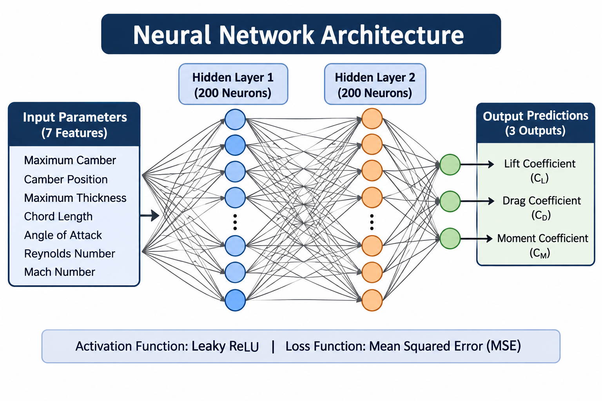

# Neural Network-Based Airfoil Aerodynamic Performance Prediction

## Project Overview

This project investigates the application of **Artificial Neural Networks (ANNs)** to predict the aerodynamic performance of airfoil geometries under varying flow conditions. A feedforward neural network was developed in Python using PyTorch and trained using aerodynamic simulation data generated with XFOIL.

The model predicts three fundamental aerodynamic coefficients: **lift coefficient (CL), drag coefficient (CD), and moment coefficient (CM)**. Rather than requiring a new XFOIL simulation for every prediction, the trained neural network approximates the relationship between airfoil geometry, flow conditions, and aerodynamic performance.

A dataset containing **200 unique NACA four-digit airfoil geometries** was generated and evaluated across different angles of attack, Reynolds numbers, and Mach numbers. The resulting dataset was used to train, validate, and independently test the neural network.

The primary objective was to evaluate the ability of a neural network to generalize to airfoil geometries that were not included in the training dataset.

## Methodology

The project was developed using **Python, PyTorch, NumPy, Pandas, and Matplotlib**, with XFOIL serving as the aerodynamic simulation tool used to generate training data.

### Airfoil Geometry Generation and XFOIL Simulations

A Python program was developed to generate unique NACA four-digit airfoil geometries by varying:

- Maximum camber
- Position of maximum camber
- Maximum thickness

The generated airfoil coordinates were supplied to XFOIL to calculate aerodynamic performance under different operating conditions.

The simulations varied:

- **Angle of attack:** -2° to 8°
- **Reynolds number:** Eight different Reynolds number conditions
- **Mach number:** 0.0, 0.1, 0.2, and 0.3

XFOIL-generated lift, drag, and moment coefficients were collected and organized into a structured dataset for machine-learning development.

  <figure>
    
    <figcaption>Airfoil geometry and aerodynamic simulation setup in XFOIL.</figcaption>
  </figure>

### Dataset Preparation and Processing

The dataset contained seven input parameters and three output parameters.

**Input parameters:**

- Maximum camber
- Camber position
- Maximum thickness
- Chord length
- Angle of attack
- Reynolds number
- Mach number

**Predicted aerodynamic outputs:**

- Lift coefficient (CL)
- Drag coefficient (CD)
- Moment coefficient (CM)

The dataset was divided by unique airfoil geometry rather than individual simulation rows to prevent data leakage between training, validation, and testing datasets.

| Dataset | Unique Geometries | Allocation |
|:---|---:|---:|
| Training | 160 | 80% |
| Validation | 20 | 10% |
| Testing | 20 | 10% |
| **Total** | **200** | **100%** |

All input and output parameters were standardized using the training dataset statistics. The same normalization parameters were then applied to the validation and testing datasets to prevent data leakage during preprocessing.

### Complete Aerodynamic Dataset

The complete dataset contains the generated NACA airfoil geometries, operating conditions, and corresponding XFOIL aerodynamic coefficients.

    <pre id="csv-content" style="margin:0; font-family:monospace; font-size:12px; white-space:pre; color:#222;">Loading aerodynamic dataset...</pre>

    <a href="/airfoil_dataset.csv" target="_blank">Download Complete Dataset (CSV)</a>

### Artificial Neural Network Architecture

A fully connected feedforward neural network was implemented using PyTorch.

The network consisted of:

- Seven input neurons
- Two fully connected hidden layers
- Leaky ReLU activation functions
- Three output neurons corresponding to CL, CD, and CM

Four network configurations were investigated by varying the number of neurons in each hidden layer:

- 50 neurons per hidden layer
- 100 neurons per hidden layer
- 150 neurons per hidden layer
- 200 neurons per hidden layer

  <figure>
    

### Training Procedure

Each network configuration was trained for 3,000 epochs using the following training parameters:

- **Optimizer:** Adam
- **Initial learning rate:** 0.01
- **Learning rate scheduler:** Cosine Annealing
- **Loss function:** Mean Squared Error (MSE)
- **Epochs:** 3,000

Training and validation losses were recorded throughout the optimization process. The final architecture was selected based on its validation performance, with the testing dataset reserved for independent evaluation.

## Key Results

### Neural Network Architecture Comparison

The four network configurations were compared using their final training and validation losses.

| Hidden Layer Neurons | Training Loss | Validation Loss |
|---:|---:|---:|
| 50 | 0.002709 | 0.008902 |
| 100 | 0.001759 | 0.010113 |
| 150 | 0.001538 | 0.008874 |
| 200 | 0.001312 | 0.006616 |

The **200-neuron architecture** achieved the lowest final validation loss and was selected as the final model.

  <figure>
    
    <figcaption>Training and validation loss throughout the optimization process for the selected 200-neuron architecture.</figcaption>
  </figure>

### Independent Testing Performance

The selected neural network was evaluated using 20 airfoil geometries that were excluded from training and validation.

The model achieved the following root mean squared errors (RMSE) when compared against XFOIL-generated aerodynamic coefficients:

| Aerodynamic Coefficient | Testing RMSE |
|:---|---:|
| Lift Coefficient (CL) | 0.005026 |
| Drag Coefficient (CD) | 0.000345 |
| Moment Coefficient (CM) | 0.000772 |

These results demonstrate the model's ability to approximate XFOIL-generated aerodynamic coefficients for previously unseen airfoil geometries.

### Actual vs. Predicted Aerodynamic Coefficients

Actual-versus-predicted comparisons were generated for all three aerodynamic coefficients to evaluate the agreement between neural network predictions and XFOIL reference values.

  <figure>
    
    <figcaption>Actual versus predicted lift coefficient (CL) for the independent testing dataset.</figcaption>
  </figure>
  <figure>
    
    <figcaption>Actual versus predicted drag coefficient (CD) for the independent testing dataset.</figcaption>
  </figure>
  <figure>
    
    <figcaption>Actual versus predicted moment coefficient (CM) for the independent testing dataset.</figcaption>
  </figure>

## Major Findings

- A feedforward neural network was developed to predict three aerodynamic coefficients using airfoil geometry and flow-condition parameters.
- Dividing the dataset by unique airfoil geometry allowed model performance to be evaluated on geometries excluded from training.
- Increasing hidden-layer width improved final validation performance across the investigated configurations, with the 200-neuron architecture achieving the lowest validation loss.
- The selected architecture achieved testing RMSE values of 0.005026 for CL, 0.000345 for CD, and 0.000772 for CM.
- The results demonstrate the potential of neural networks as computationally efficient surrogate models for aerodynamic analysis.

## Conclusion

This project established a machine-learning approach for approximating airfoil aerodynamic performance using XFOIL-generated simulation data. The final PyTorch model demonstrated strong predictive agreement with the reference simulation data across 20 previously unseen airfoil geometries.

The developed framework provides a foundation for future work involving larger aerodynamic datasets, experimental validation, and machine-learning-assisted airfoil design and optimization.

**Note:** Model performance was evaluated against XFOIL-generated data rather than experimental wind tunnel measurements. The reported accuracy therefore represents agreement with the simulation data used as the reference.
